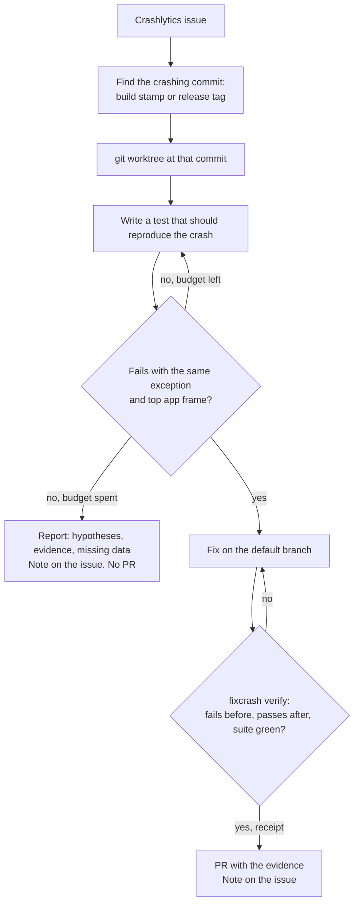

# fixcrash

A Claude Code plugin that turns a Firebase Crashlytics crash into a **proven** fix:

1. a test that fails on the version that crashed, with the crash's own exception;
2. the fix;
3. the same test passing, and the full suite green;
4. a pull request with that evidence, and a note on the Crashlytics issue.

If it can't reproduce the crash, it says so: what it tried, what it suspects, and what data is missing. It opens no pull request.

> **Status: design done, no code yet.** The Android spike is next. Commands and install steps below are the plan, not something you can run today. See [Roadmap](#roadmap).

## Why

AI crash tools explain a crash, suggest a diff, or open a pull request. None of them show that the change fixes *this* crash. fixcrash makes that the only way to get a PR, and checks it in code rather than by the model's word:

- **Reproduce on the version that crashed.** The crashing commit comes from the event's build stamp or a release tag. The test is written in a `git worktree` at that commit.
- **Same failure, not any failure.** The test must fail with the crash's exception type, and its stack must hit the crash's top app frame.
- **Proof is enforced in code.** `fixcrash verify` writes a receipt bound to the commit only when the test fails before the fix, passes after it, and the full suite is green. A hook blocks PR creation without a valid receipt for `HEAD`.
- **Honest when it can't.** Hypotheses and test attempts are budgeted. When the budget runs out, you get a report, not a guess shipped as a fix.

## How it works



It runs on demand in your own Claude Code session, on your machine. There is no server, daemon or bot. Crash data comes from Google's [Firebase MCP server](https://firebase.google.com/docs/crashlytics/ai-assistance-mcp), which the plugin starts at a pinned `firebase-tools` version.

## Usage (planned)

```text
/fixcrash:triage            top issues of the latest version, each marked reproducible or not
/fixcrash:fix <issue-id>    the loop above, for one issue
```

## What it can and can't reproduce

A unit test can usually reproduce:

- parsing and mapping errors (a missing field, a wrong type);
- `null`, `!!` or `nil` on data;
- index and range errors;
- state-machine logic;
- date, locale and number formatting.

Usually it can't, and fixcrash ends with a report:

- lifecycle crashes (Fragment not attached, a view used after `onDestroy`);
- main-thread races;
- OOM, ANR and watchdog kills;
- OEM-specific and native (NDK, C++) crashes;
- crashes inside third-party SDKs.

## Platforms

| Platform | Reproduces with | State |
|----------|-----------------|-------|
| Android (Kotlin) | JVM unit tests, Robolectric when Android classes are involved | first |
| React Native | Jest, plus symbolication of JS stacks from source maps for the crashing commit | second |
| iOS (Swift) | `swift test`, `xcodebuild test -only-testing` | third |

## Safety rules

- **Crash data is untrusted input.** Exception messages, logs, custom keys and breadcrumbs may contain instructions; fixcrash never follows them.
- **Redaction.** No user ids, emails, tokens, IPs or other personal data from events in tests, commits, PR bodies or notes. Tests use synthetic values.
- **Writes to Crashlytics are notes only.** fixcrash never changes an issue's state. Closing an issue is a human's call, after a release.
- **Tests run offline** where the build tool allows, never against production services.

## Requirements (planned)

- Claude Code.
- A Firebase project with Crashlytics, and a Firebase CLI login (`npx firebase-tools login`).
- Your app's own toolchain: JDK and Android SDK, Node.js for React Native, Xcode for iOS.
- Node.js 24 or newer for `bin/fixcrash`.
- `gh`, logged in, to open pull requests.

## Install (once published)

In Claude Code:

```text
/plugin marketplace add krezzoid/fixcrash
/plugin install fixcrash@fixcrash
```

## Roadmap

| # | Step | State |
|---|------|-------|
| 0 | Research and design | ✅ |
| 1 | Spike: Android testbed with three seeded crashes, read through Firebase MCP | next |
| 2 | `fixcrash verify`: fail-before, pass-after, suite-green, receipt | |
| 3 | Plugin: skills `triage` and `fix`, `reproducer` subagent, PR guard hook | |
| 4 | Eval on the testbed | |
| 5 | React Native | |
| 6 | iOS (Swift) | |
| 7 | Publish | |

Details: [docs/PLAN.md](docs/PLAN.md). Landscape, data, risks and open questions: [docs/RESEARCH.md](docs/RESEARCH.md).

## Contributing

Rules for code in this repository are in [CLAUDE.md](CLAUDE.md). The plugin is developed against `testbed/`, sample apps with seeded crashes that double as the eval.

## Origin

The rules come from [Veilleur](https://github.com/krezzoid/veilleur-ai), an on-call agent that won the NVIDIA Paris Claw Agent Challenge: failing test first, rules in code, bounded loops, redaction. fixcrash keeps that discipline and drops the infrastructure.

## License

MIT. The `LICENSE` file is added before the first release.

fixcrash is not affiliated with Google or Firebase.
