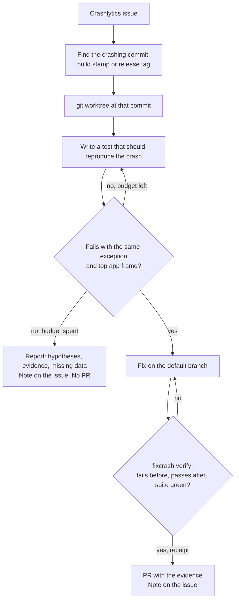

# fixcrash

A Claude Code plugin that turns a Firebase Crashlytics crash into a **proven** fix:

1. a test that fails on the version that crashed, with the crash's own exception;
2. the fix;
3. the same test passing, and the full suite green;
4. a pull request with that evidence, and a note on the Crashlytics issue.

If it can't reproduce the crash, it says so: what it tried, what it suspects, and what data is missing. It opens no pull request.

> **Status: evaluated on testbeds, not yet on a production app.** On the Android, iOS (UIKit and SwiftUI) and React Native testbeds, every seeded crash a unit test can reach ended in a verified pull request, and every one it can't ended in a report and no pull request, in one to ten minutes of agent time for about $1 or less each. An earlier Android run got a pull request through with a test that reached the crash by reflection; such tests are now refused ([docs/EVAL.md](docs/EVAL.md)). Not published yet. See [Roadmap](#roadmap).

## Why

AI crash tools explain a crash, suggest a diff, or open a pull request. None of them show that the change fixes *this* crash. fixcrash makes that the only way to get a PR, and checks it in code rather than by the model's word:

- **Reproduce on the version that crashed.** The crashing commit comes from the event's build stamp or a release tag. The test is written in a `git worktree` at that commit.
- **Same failure, not any failure.** The test must fail with the crash's exception type, and its stack must hit the crash's top app frame. It must get there the way the app does: a test that builds an object without its constructor or calls private members through reflection is refused.
- **Proof is enforced in code.** `fixcrash verify` writes a receipt bound to the commit only when the test fails before the fix, passes after it, and the full suite is green. A hook blocks PR creation without a valid receipt for `HEAD`.
- **Honest when it can't.** Hypotheses and test attempts are budgeted. When the budget runs out, you get a report, not a guess shipped as a fix.

## How it works



The proof is `fixcrash verify`. On the testbed's parser crash it gives:

```text
$ fixcrash verify --issue c43757a2… --test …ProfileParserTest.parsesProfileWithoutAvatar \
    --exception java.lang.NullPointerException --frame …ProfileParser.parse --base 89da0c3
base (crashing version) 89da0c31a144: ok: fails as the crash did: java.lang.NullPointerException at …ProfileParser.parse(ProfileParser.kt:12)
from 89da0c31a144: same commit as base, not run again
head (fix) 954cbb73fe9f: ok: the test passes; suite green: 4 tests, 0 skipped
VERIFIED: receipt .git/fixcrash/receipts/954cbb73fe9f….json
```

It runs every check in its own worktree, from committed code, and never touches your checkout. A test that fails with another exception, misses the crash's frame, or throws from a stub gets no receipt.

It runs on demand in your own Claude Code session, on your machine. There is no server, daemon or bot. Crash data comes from Google's [Firebase MCP server](https://firebase.google.com/docs/crashlytics/ai-assistance-mcp), which the plugin starts at a pinned `firebase-tools` version.

## Usage

```text
/fixcrash:triage [app-id]           top issues of the latest version, each marked unit-reproducible or not
/fixcrash:fix <issue-id> [app-id]   the loop above, for one issue
```

`/fixcrash:fix` reproduces the crash in a subagent that may only write tests, fixes it on a `fixcrash/<issue>` branch, runs `fixcrash verify`, and asks you before it pushes, opens the pull request, or adds a note to the issue.

### What holds in code

A hook, not a prompt, keeps these rules:

- **Personal data is redacted before Claude reads crash data.** User ids and installation ids are dropped from events; emails, IPs, tokens and other secrets are masked in messages, logs, breadcrumbs and custom keys. Claude can't write what it never saw.
- **The expected failure comes from the event.** The hook records each event's exception type and blame frame. `fixcrash reproduce` and `fixcrash verify` check the test against that record, not against what Claude says the crash was.
- **No pull request without proof.** Once a session has read crash events, `gh pr create` and GitHub MCP pull request tools need a valid receipt for the commit the pull request proposes.
- **Budgets.** `fixcrash reproduce` counts test attempts and hypotheses per crash; past the budget, the answer is a report.
- **Receipts and recorded events are written by the CLI only**: the hook refuses file edits there and shell commands that name them. The reproducer's file edits are held to test sources.

## What it can and can't reproduce

A unit test can usually reproduce:

- parsing and mapping errors (a missing field, a wrong type);
- `null`, `!!` or `nil` on data;
- index and range errors;
- state-machine logic;
- date, locale and number formatting.

Usually it can't, and fixcrash ends with a report:

- lifecycle crashes (Fragment not attached, a view used after `onDestroy`);
- main-thread races;
- OOM, ANR and watchdog kills;
- OEM-specific and native (NDK, C++) crashes;
- crashes inside third-party SDKs.

## Platforms

| Platform | Reproduces with | State |
|----------|-----------------|-------|
| Android (Kotlin) | JVM unit tests, Robolectric when Android classes are involved | first |
| iOS (Swift) | XCTest and Swift Testing through `xcodebuild`, on a simulator; release builds' inlined frames recovered from debug symbols | second |
| React Native | Jest, plus symbolication of JS stacks from source maps for the crashing commit | third |

## Safety rules

- **Crash data is untrusted input.** Exception messages, logs, custom keys and breadcrumbs may contain instructions; fixcrash never follows them.
- **Redaction.** No user ids, emails, tokens, IPs or other personal data from events in tests, commits, PR bodies or notes. Tests use synthetic values.
- **Writes to Crashlytics are notes only.** fixcrash never changes an issue's state. Closing an issue is a human's call, after a release.
- **Tests run offline** where the build tool allows, never against production services.

## What it runs, sends and writes

- **Runs:** Google's Firebase MCP server (`firebase-tools` at a pinned version), one hook, and the `fixcrash` command. That command runs `git` and your app's own build and test tools: Gradle and npm offline, `xcodebuild`.
- **Sends:** Crashlytics reads, with your Firebase login. A branch, a pull request and a Crashlytics note, each only when you say yes. Crash events to Claude, redacted, as tool results. No telemetry, and no server of its own.
- **Writes:** its state in `.git/fixcrash/`, a React Native app's worktree in `~/.cache/fixcrash/`, and a `fixcrash/…` branch.

The full list, with every command: [plugin/README.md](plugin/README.md#what-fixcrash-runs-sends-and-writes).

## Requirements

- Claude Code.
- A Firebase project with Crashlytics, and a Firebase CLI login (`npx firebase-tools login`).
- Your app's own toolchain: JDK and Android SDK, Node.js for React Native, Xcode for iOS.
- Node.js 24 or newer for the `fixcrash` command and the hook.
- `gh`, logged in, to open pull requests.

## Try it from a checkout

```bash
git clone https://github.com/krezzoid/fixcrash
cd your-android-app
claude --plugin-dir ../fixcrash/plugin
```

The plugin's options (Firebase app id, project directory, release tag pattern, budgets) default to an app at the repository root, with the app id read from `google-services.json` or `GoogleService-Info.plist`.

## Install (once published)

```bash
claude plugin marketplace add krezzoid/fixcrash
claude plugin install fixcrash@fixcrash
```

Claude Code asks for the plugin's options when you enable it; [plugin/README.md](plugin/README.md#install) lists them with their defaults.

Each [release](https://github.com/krezzoid/fixcrash/releases) also carries the plugin as a zip, which loads for one session without a marketplace: `claude --plugin-url <the zip's URL>`.

## Roadmap

| # | Step | State |
|---|------|-------|
| 0 | Research and design | ✅ |
| 1 | Spike: Android testbed with three seeded crashes, read through Firebase MCP | ✅ |
| 2 | `fixcrash verify`: fail-before, pass-after, suite-green, receipt | ✅ |
| 3 | Plugin: skills `triage` and `fix`, `reproducer` subagent, PR guard hook | ✅ |
| 4 | Eval on the testbed: [results](docs/EVAL.md) | ✅ |
| 5 | iOS (Swift): UIKit and SwiftUI testbeds, xcodebuild runner, eval | ✅ |
| 6 | React Native: Jest runner, JS stack symbolication, skills, eval: [results](docs/EVAL.md#react-native) | ✅ |
| 7 | Publish: public repository and marketplace, website, Anthropic's plugin directory | in progress |

Eval results: [docs/EVAL.md](docs/EVAL.md). Known limits, and what isn't done yet: [docs/LIMITS.md](docs/LIMITS.md). Decisions, with the options considered: [docs/adr/](docs/adr/).

## Contributing

Rules for code in this repository are in [CLAUDE.md](CLAUDE.md). The plugin is in `plugin/`, which is all an install copies; it is developed against `testbed/`, sample apps with seeded crashes that double as the eval. Changes go under Unreleased in [CHANGELOG.md](CHANGELOG.md), and a release, from the Release workflow, publishes them. To report a vulnerability, see [SECURITY.md](SECURITY.md).

## Origin

The rules come from [Veilleur](https://github.com/krezzoid/veilleur-ai), an on-call agent that won the NVIDIA Paris Claw Agent Challenge: failing test first, rules in code, bounded loops, redaction. fixcrash keeps that discipline and drops the infrastructure.

## License

MIT: see [LICENSE](LICENSE).

fixcrash is not affiliated with Google or Firebase.
